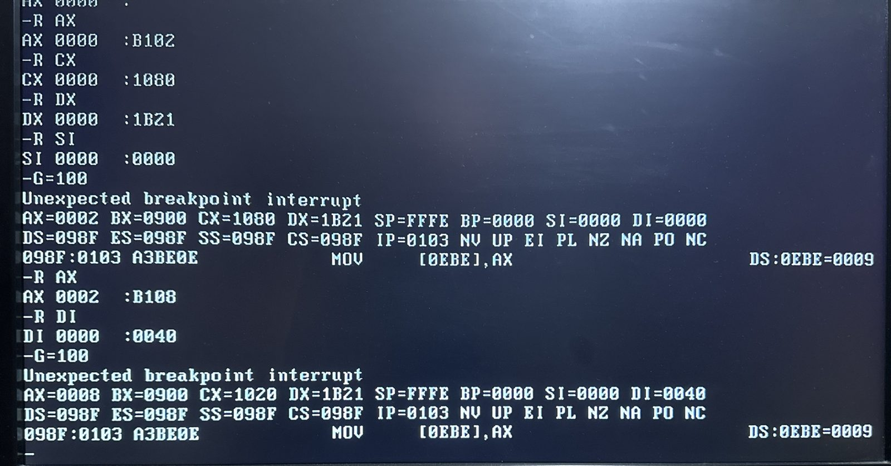
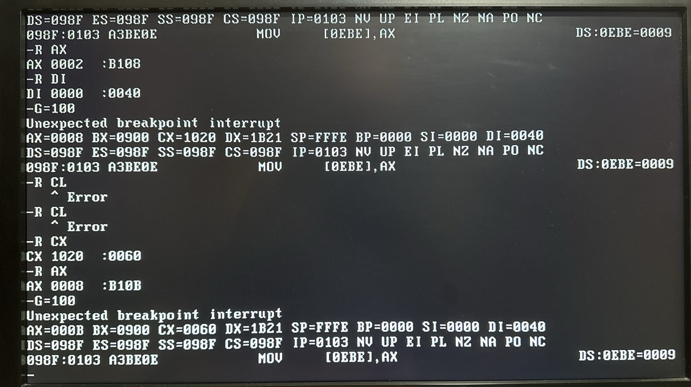
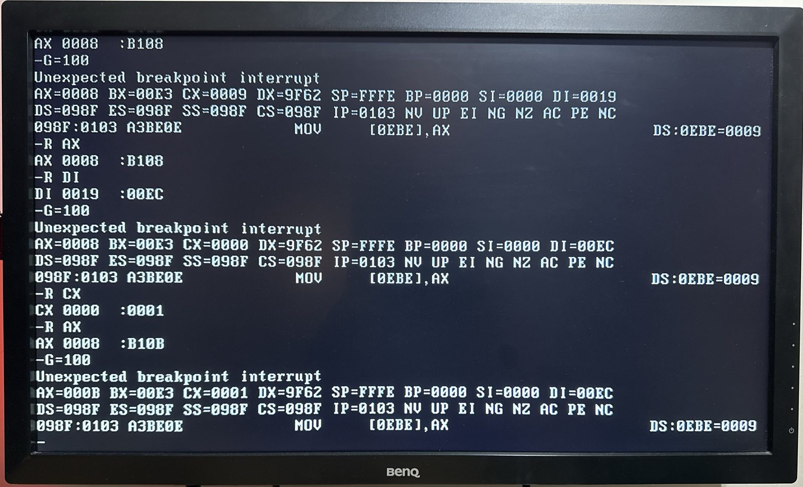
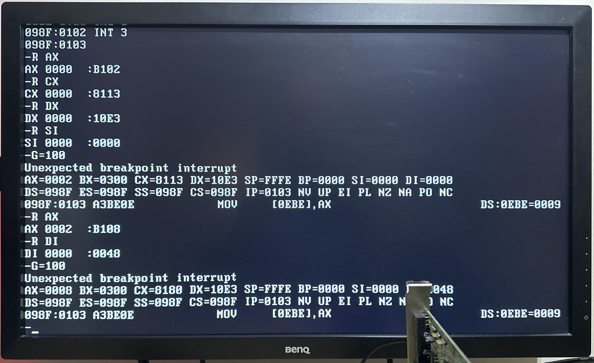
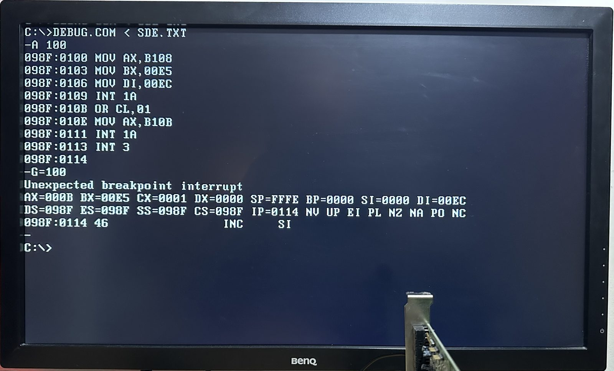

<!-- DRAFT -->
<!-- TODO: hero. Candidates: the X10SAE FM video still, or one of the DEBUG screen photos below. -->

In [the last post](), I went hunting for the fastest motherboard and CPU that can (in theory!) still play DOS games on an old-school, Sound Blaster compatible card. Luckily, I already owned two boards that fit the bill: an ASUS Z87-PRO and a Supermicro X10SAE.

Now for the real test: can I get it all working?


### Why it won't just work

I don't expect to plug a PCI sound card in and have DOS games find it. As I covered last time, a game's write to the standard Sound Blaster address (220h) has two hops to make before it reaches the card:

1. The chipset's PCIe [root port](#root-port)
2. The [PCIe-to-PCI bridge](#pcie-to-pci-bridge)

By default, neither one will route writes to the sound card.


*The two hops again. Both need subtractive decode turned on.*

The plan is to turn on [subtractive decode](#subtractive-decode) at both hops. This means addresses nobody else claims, like 220h, will fall through to the card. That's the theory, anyway. I'm hoping it routes them correctly, but I won't know until I try.

Subtractive decode starts out disabled, so we'll need to enable it ourselves, by changing the **PCI configuration registers**.


### A quick detour: registers and PCI configuration space

A **[register](#register)** is a small storage slot inside a chip, usually 8, 16 or 32 bits wide. Software reads them to find out what the chip is doing, and writes them to tell it what to do.

Every PCI device, including bridges and the chipset's root ports, has a block of these called its **[configuration space](#pci-configuration-space)**. The first part tells the PC what the device is, who made it etc. But the rest is up to the chip's maker, and that's where features like subtractive decode live.

The BIOS fills most of the configuration space at boot, but software can read and write it at any time while the PC is running. In DOS, we can poke at the registers directly: first to find our device by maker and model number, and then to read or write any byte of its configuration space. Nothing written there survives a power-off. Every boot resets back to the BIOS's defaults.


### But which bits?

After consulting the chipset and bridge datasheets, I found the registers and bits I need:

| Hop | Chip | Register | Bit |
|---|---|---|---|
| Bridge (the Z87-PRO's adapter) | ASMedia ASM1083 | 40h | Bit 6, "Patch subtractive decode enable (Legacy enable)" |
| Bridge (built into the X10SAE) | IDT 89HPEB383 | 48h | Bit 7, `LEGACY` |
| Chipset | Intel 8-series root port | ECh | Bit 0, "Subtractive Decode Enable" (SDE) |

But there's one catch on the chipset side. The 8-series chipset has several root ports, each with its own SDE bit, and its datasheet says only one can be on at a time. So first we need to find out which root port leads to the sound card.

(IMPROVEMENT NOTE: we should add a definition for root ports to our glossary link it)


### A quick detour: what DEBUG is

Today, debugging usually means stepping through your code in an IDE. Back in the 1980s we had **[`DEBUG`](#debug)**.

It's a small program that came with MS-DOS from the very first version (FreeDOS has its own), and it allows you to debug raw machine state: memory, registers, and I/O ports.

That makes it handy for much more than finding bugs. You can type a few lines of assembly language with its `A` (assemble) command, set the CPU’s registers with `R`, run the code with `G` (go), and see what the registers hold afterwards. In other words, it’s a great way to poke at the hardware directly, built into DOS.

Time to get started!


### The Z87-PRO

For the sound card, I picked a [Yamaha YMF724](). It's a late-90s PCI card, built to be [Sound Blaster](#sound-blaster) compatible in DOS, with Yamaha's own FM synth on board. Its DOS driver package comes with a setup tool, `SETUPDS`, that turns on the card's [legacy mode](#legacy-mode), plus a test program that plays FM music.

The Z87-PRO has no PCI slots, so the card goes in a PCIe-to-PCI adapter: the same one from [my Voodoo 2 experiments](), with an ASM1083 bridge chip.

The bridge came first. The goal is to turn on one bit: bit 6 of the ASM1083's register 40h. I did it by hand at the `DEBUG` prompt, one step at a time.

**Step 1: a tiny program.** With `A 100`, I typed in just two instructions. `INT 1A` calls the PCI BIOS, and `INT 3` hands control back to `DEBUG` afterwards, which then prints all the CPU's registers so I can see the result. Each BIOS call after that works the same way: set the registers with `R`, then run the program with `G=100`.

**Step 2: find the bridge.** I set `AX` to B102h (the PCI BIOS's "find a device" call), `CX` to 1080h (the ASM1083's device ID) `DX` to 1B21h (ASMedia's vendor ID) and `SI` to 0 (the first one found), then ran it. The BIOS came back with `BX=0900`: the bridge is on bus 09h. And `NC` (no carry) at the end of the second line means the call worked.

**Step 3: read register 40h.** `AX` to B108h ("read a byte") and `DI` to 40h (the register), then run.


*Finding the ASM1083 (`BX=0900`), then reading its register 40h (`CX=1020`).*

The byte read lands in `CL`, the right-hand half of `CX`: 20h. Bit 6 (40h) is off.

**Step 4: turn bit 6 on.** The new value is 20h + 40h = 60h. My first try was `R CL`, which `DEBUG` rejected: it only lets you edit whole 16-bit registers. So I set `CX` to 0060 instead.

**Step 5: write it back.** `AX` to B10Bh ("write a byte"), and run.


*Two `R CL` errors, then `CX=0060` and the write. `NC`: the BIOS accepted it.*

`NC` again, so the BIOS accepted the write. That doesn't prove the card can hear anything yet, but it's one hop done.

Typing all that in on every boot would get old fast, so I saved the same steps as a script, `BRIDGEFX.TXT`. Here are those steps from it, with comments added (the real file has none):

```nasm
A 100              ; start assembling at address 100h
MOV AX,B102        ; step 2: find the device...
MOV CX,1080        ;   ...with device ID 1080h (the ASM1083)
MOV DX,1B21        ;   ...from vendor 1B21h (ASMedia)
XOR SI,SI          ;   ...the first one found
INT 1A             ; the BIOS returns where it found it in BX
MOV AX,B108        ; step 3: read register 40h...
MOV DI,0040        ;   ...into CL
INT 1A
OR CL,40           ; step 4: turn on bit 6 (40h), leaving the others alone
MOV AX,B10B        ; step 5: write CL back to register 40h
INT 1A
INT 3              ; stop, and show the registers
```

Next, the card. `SETUPDS` found the YMF724 straight away, and its native sound test played fine. But neither of those uses the old I/O ports. `SETUPDS` finds the card through its configuration space, which, as we've just seen, needs no help from subtractive decode. And the native test uses the card's modern addresses.

The real test was whether anything could find a Sound Blaster at 220h. With the bridge fixed and the [`BLASTER` variable](#blaster-variable) set, `SETUPDS` couldn't. Neither could Creative's own `SBTEST`, which shares no code with Yamaha's tools.

<!-- TODO: image. Vault: PCI Sound Cards 23 (SETUPDS still fails). -->

That was expected. The chipset's hop was still closed.

Unlike the bridge, the chipset's root ports don't need finding: they're always at the same place, bus 0, device 28, functions 0 to 7. The PCI BIOS packs that into `BX`, so they're `00E0` to `00E7`. Each root port records the number of the bus behind it in register 19h, and the BIOS had put the adapter's bridge on bus 09h. So I wrote a small script for each function, `FINDF0.TXT` to `FINDF7.TXT`, to read that register:

```nasm
A 100
MOV AX,B108        ; read a byte of configuration space...
MOV BX,00E3        ;   ...from bus 0, device 28, function 3
MOV DI,0019        ;   ...register 19h: the bus behind this port
INT 1A
INT 3
```

Then I worked through them:

| Root port function | Bus behind it |
|---|---|
| 0 | 07h |
| 1 | 08h |
| 2 | none |
| **3** | **09h** |

Function 3. I read its register ECh, and SDE was 0. I set `CX` to 1 and wrote it back.


*Finding and setting SDE on the Z87-PRO by hand. Top: register 19h says bus 09h is behind this port (`CX=0009`). Middle: SDE reads 0. Bottom: the write of 1 succeeds.*

Then the keyboard froze solid.

<!-- TODO (James): a line on your reaction here, at the first freeze or the second. -->

Nothing I typed reached the screen, and the Num Lock light was stuck on. I power-cycled and tried again with a PS/2 keyboard instead of USB, in case the BIOS's USB keyboard support was the problem. It froze in exactly the same way.

The third time, I took away everything I could. Real MS-DOS instead of FreeDOS, booted from a floppy disk instead of a USB stick, with the BIOS's Fast Boot off and its USB 3 controller disabled. By now the write was a script too, `ROOTPORT.TXT`. Same freeze, the moment SDE went on.

Luckily, it did no lasting harm. Configuration space is cleared at power-off, so a power-cycle brought everything back each time.

Looking for anyone who'd seen this before, I found the dISAppointment project, which adds a real ISA slot to modern PCs. Its builders hit something very similar: turning on subtractive decode broke the keyboard controller and sometimes hung the whole machine. Their best guess was a clash with the board's Super I/O chip, which handles the keyboard on modern boards. They never found a fix.

Three identical freezes, and no fix from anyone else. I set the Z87-PRO aside and moved on to the X10SAE.


### The X10SAE

The X10SAE has real PCI slots, fed by the IDT 89HPEB383 bridge on the board.

<!-- TODO: image. Vault: PCI Sound Cards 39 (Port 60/64 Emulation help text). -->

Before going near DOS, I went through the BIOS. There was no setting for subtractive decode, but in the USB settings I found something I hadn't seen on the ASUS: "Port 60/64 Emulation", enabled. Ports 60h and 64h belong to the keyboard controller, and the help text explains that this setting fakes them so a USB keyboard works in "non-USB aware OSes". In other words, DOS. Something sitting between the keyboard and the chipset seemed worth getting out of the way, so I made a note to turn it off before trying SDE.

In DOS, I found the IDT bridge by hand with `DEBUG` (vendor 10E3h, device 8113h), then read its register 48h.


*Reading the IDT bridge's register 48h on the X10SAE. The byte read lands in `CL`, the right-hand half of `CX=8180`: 80h, so bit 7 was already on.*

Bit 7 was already set! Supermicro's BIOS turns on the bridge's legacy mode by itself, so there was nothing to do.

Even so, Yamaha's test program still failed, and `SETUPDS` still couldn't find a Sound Blaster. One hop left.

The `FINDFn` scripts found the bridge's bus, 03h, behind root port function 5. `SDE.TXT` is the same script as `ROOTPORT.TXT`, with `MOV BX,00E5` for function 5. This time, I prepared first: a PS/2 keyboard, and Port 60/64 Emulation turned off. Then I ran it.


*`SDE.TXT` on the X10SAE: the script, then the result. `CX=0001` means SDE is on, and `NC` means the BIOS call worked.*

The keyboard kept working.


### First sound

I ran Yamaha's FM test program again. This time, it played music.

<!-- TODO: video. Vault: PCI Sound Cards 47 (X10SAE FM audio working, .MOV), needs uploading to YouTube. -->

That's FM music from a PCI sound card, in DOS, on a Haswell Xeon. The writes to 388h now make it through both hops to the card.

So why did my keyboard freeze on the Z87-PRO? I still don't know. It could be the Port 60/64 Emulation setting, the different Super I/O chip (a Nuvoton NCT6776D, against the ASUS's NCT6791D), or something about that particular root port. I haven't been back to find out yet. For now, the [X10SAE]() is the board.


### What's next

That's address routing working: the card answers at the right addresses, and the game's accesses reach it.

FM music only needs those writes. Digitised sound, the explosions and speech in most games, also needs the other two requirements: interrupts and DMA. That's the next post.


### Related on this site

- [Get PCI Sound Cards Working on a Modern PC]() — the project this post is part of
- [Finding the Fastest Possible DOS PC]()
- [Why Don't PCI Sound Cards Work on a Modern PC?]()
- [Supermicro X10SAE]()
- [Yamaha YMF724]()
- [Technical Glossary]()
