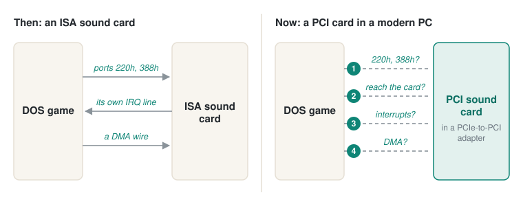
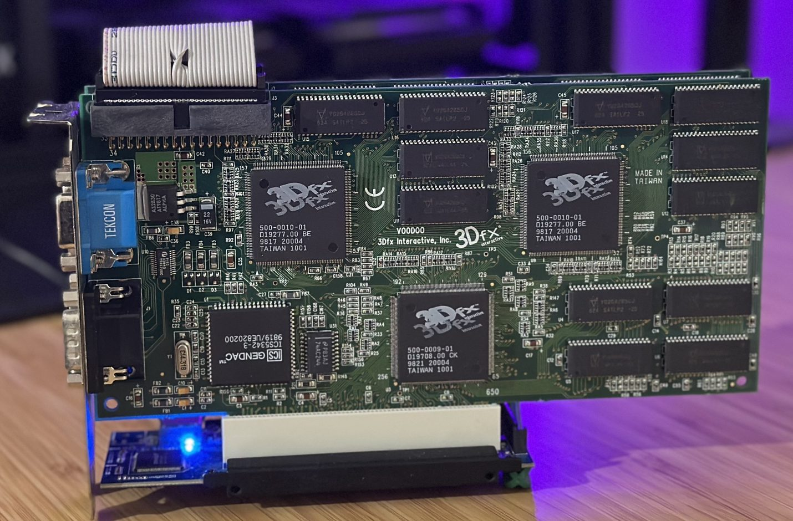

As I explained in [the last post](), I'm on a mission to get real DOS audio working on the fastest PC possible. That led me to PCI sound cards, and today I'm hunting for the fastest chipset and CPU combination that can still run one. Let's find that limit!

### Where does the limit come from?

The last post split the problem into four parts. Most of them are about the sound card and how it's driven. One of them is about the PC itself: **getting there at all**.

*The four problems from the last post. Number 2 is the one that depends on the PC: can the game's accesses reach the card at all?*

A DOS game looks for a Sound Blaster at fixed I/O addresses: 220h for the card and 388h for the FM chip. A PCI sound card in [legacy mode](#legacy-mode) should answer there. The trouble is getting the game's accesses to the card in the first place.

On a modern PC the card sits behind two hops: the chipset's PCI Express port, then a PCIe-to-PCI bridge (on the motherboard, or on an adapter card). By default, each of those only forwards accesses to the addresses the BIOS handed out at boot. 220h was never one of them. So the game writes to 220h, nothing along the way claims it, and the access goes nowhere.

The fix is an old idea called **[subtractive decode](#subtractive-decode)**. Instead of only forwarding its own addresses, a bridge forwards *anything nobody else claimed*. Turn that on at both hops and 220h falls through to the card.

The bridge half is mostly a matter of choosing the right chip. Subtractive decode is an optional feature, but the ASMedia and IDT bridges in my machines both have a switch for it. The chipset half is out of my hands: either the chipset can do it, or it can't.

So my search turned into a simple question. Which chipsets can still do subtractive decode? Whichever is newest sets the speed limit.

### Starting with my newest PC

The obvious first candidate was my newest machine, an AM5 PC with an ASUS ROG Strix B650E-F. It even has a PCIe-to-PCI adapter fitted already, left over from my Voodoo 2 experiments. If that worked, I'd be done before I'd started.

{: width="480"}
*The PCIe-to-PCI riser from my AM5 Voodoo 2 experiments, Voodoo 2 still attached.*

Before pulling anything apart, I looked for anyone who'd tried a PCI sound card in DOS on an AMD board. In [a long-running Vogons thread on PCI sound cards and chipsets](https://www.vogons.org/viewtopic.php?p=186881#p186881), one member had, and summed up ATI and AMD chipsets like this:

> "These southbridges have virtually zero legacy capabilities available. I used some AMD 700-900 motherboards for some Phenom II CPUs and later on the FX ones. Legacy audio simply cannot be turned on. Games still report no Sound Blaster even after loading the TSRs."

Those are older boards, but as far as I can find, no later AMD chipset added anything to fix it. Not a great start. AMD is out, and my newest PC with it.

### Intel's 8-series: a promising lead

My other two candidate boards are both older Intel machines: an ASUS Z87-PRO and a Supermicro X10SAE, both from the 8-series generation (2013, Haswell). So I went to Intel's datasheet for that chipset family, expecting to dig through register tables for clues.

I didn't have to. It has a whole section on exactly this, which starts by admitting the problem:

> "PCI functionality is not supported on new generation of PCH requiring methods such as using PCIe-to-PCI bridges to enable external PCI I/O devices. To be able to use PCIe-to-PCI bridges and attached legacy PCI devices, the PCH provides PCI Legacy Mode."
>
> *[Intel 8 Series/C220 Series Chipset Family PCH datasheet](https://www.intel.com/content/dam/www/public/us/en/documents/datasheets/8-series-chipset-pch-datasheet.pdf), section 5.2.2*

It then describes exactly the trick above: both the chipset's PCIe port and the bridge behave like old subtractive PCI-to-PCI bridges, so legacy accesses fall through to the cards behind them. On the chipset side it's a single bit, "Subtractive Decode Enable", in each PCIe port's configuration registers. It's an ordinary writable setting, so in principle a small DOS program can switch it on at boot.

That was a good day. Intel didn't just leave the feature in by accident; they documented it, and gave it a name.

### Moving forward a generation at a time

With a name and a register to look for, I could step forward through Intel's chipsets and see where it disappeared.

**The 9-series** (Z97 and H97, 2014) still has the same register, and nothing in the datasheet says it's unsupported. There's no dedicated "PCI Legacy Mode" section like the 8-series has, though, so I'd call it a "probably" rather than a "yes".

**The 100-series** (Z170 and friends, 2015, Skylake) is where the trail ends. Intel says so plainly:

> "PCIe Subtractive Decode is not supported — PCI can still be supported via a PCIe-to-PCI bridge. However, legacy PCI devices (such as PCMCIA or non-plug-and-play device) that need subtractive decode are not supported."
>
> *[Intel 100 Series Chipset Family PCH datasheet, volume 1](https://www.intel.com/content/www/us/en/content-details/332690/intel-100-series-chipset-family-platform-controller-hub-pch-datasheet-volume-1.html)*

A PCI sound card in legacy mode is exactly that kind of device. Oddly, the bit is still listed in the 100-series register reference (volume 2). I read that as leftover design, not a feature: volume 1 is where Intel says what's actually supported, and it says no.

**The 200-series** (Z270, 2017, Kaby Lake) uses the same wording.

Here's where that leaves things:

| Chipset | Era | PCI Legacy Mode? | Evidence |
|---|---|---|---|
| 8-series (Z87, H87, Q87, C220) | 2013, Haswell | **Yes** | Its own datasheet section |
| 9-series (Z97, H97) | 2014, Haswell Refresh and Broadwell | **Probably** | The register is there, with no note saying it's unsupported |
| 100-series (Z170 and friends) | 2015, Skylake | **No** | Intel says so in the datasheet |
| 200-series (Z270) | 2017, Kaby Lake | **No** | Same wording as the 100-series |

I haven't tested any of this on real hardware yet. On the evidence, I don't expect anything newer than the 9-series to work, but I can't say it's impossible: a BIOS or firmware trick could, in principle, forward the accesses some other way.

### So how fast can we go?

The limit is the 8-series and 9-series: the Haswell and Broadwell generation, on boards from 2013 and 2014.

That just leaves the CPU. The king of the castle is the Core i7-4790K (Haswell Refresh, 4.0 GHz, 4.4 GHz with turbo). It's the highest-clocked chip of the generation, and it runs on both 8-series and 9-series boards (my Z87-PRO just needs a BIOS update). The Broadwell i7-5775C needs a 9-series board, and it's clocked lower. That makes the 4790K likely the fastest CPU there is for DOS gaming with a real PCI sound card.

I don't own one. But I checked what I do have, and was pleasantly surprised:

| CPU | Board | Base clock | Turbo |
|---|---|---|---|
| Core i7-4790K (the fastest) | 8- or 9-series | 4.0 GHz | 4.4 GHz |
| Xeon E3-1276 v3 (mine) | X10SAE | 3.6 GHz | 4.0 GHz |
| Core i7-4770K (mine) | Z87-PRO | 3.5 GHz | 3.9 GHz |

They're all the same Haswell core, so the clocks compare directly: mine are within about 10 to 12% of the 4790K. In DOS terms they're very fast, far quicker than the Core 2 in my OptiPlex 380, which already runs [Quake at 800×600 at a locked 60fps]().

So it turns out I was already sitting on pretty much the fastest hardware possible:

- an **ASUS Z87-PRO** (8-series) with a Core i7-4770K, and the ASMedia PCIe-to-PCI adapter card from [my Voodoo 2 experiments]()
- a **Supermicro X10SAE** (C226, the workstation version of the 8-series) with a Xeon E3-1276 v3, and real PCI slots fed by an onboard PCIe-to-PCI bridge chip

### What's next

That wraps up the first phase of the research. I know the fastest boards and CPUs that can do this, and I have them.

The second phase is the bridge chips: the other half of the subtractive decode trick, and how to switch it on in each of them. None of this solves DMA, either. That's still a separate problem.

### Related on this site

- [Get PCI Sound Cards Working on a Modern PC]() — the project this post is part of
- [Why Don't PCI Sound Cards Work on a Modern PC?]()
- [I Love Software Rendering]()
- [3Dfx Voodoo 2 on a Modern PC!]()
- [Doom on a Core i7 PC in native DOS, with SBEMU]()
